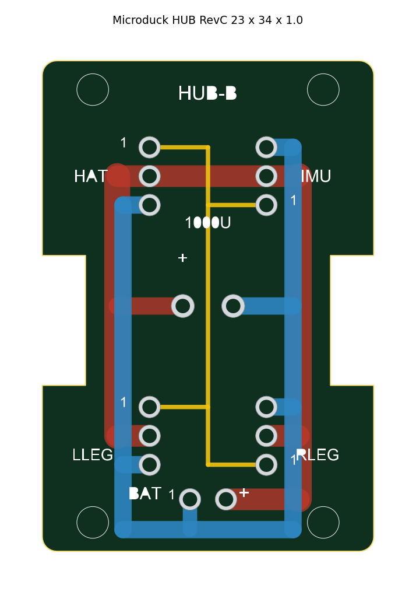
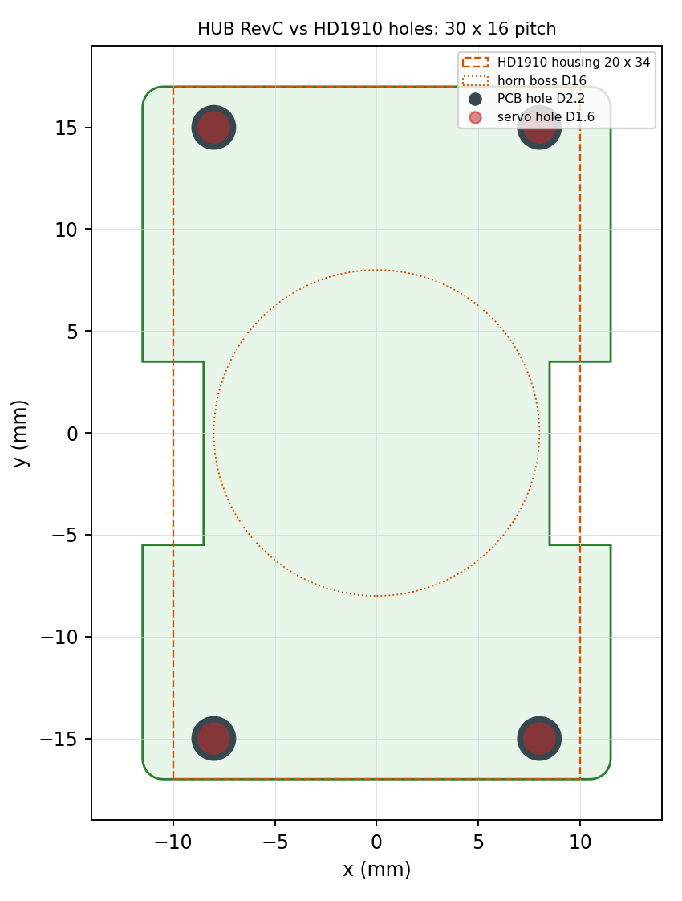

# Microduck Hub Board RevC

[简体中文](README.md) | **English**



A **passive 4-port servo bus hub** for the **Microduck** biped (Feetech HD1910, 15 servos).
Battery, HAT, IMU and both legs come together on a 23 × 34 mm board that also carries the 1000 µF bulk capacitor.

> This is **not** the official board. The official HUB belongs to the
> [kissqy/Microduck-kissqy](https://github.com/kissqy/Microduck-kissqy) project and is published under its author's
> personal non-commercial terms. This board was laid out from scratch with the same port definitions and the same
> outline, then released here under CERN-OHL-S-2.0. No file from that project is included.

## What problem it solves

HD1910 is a daisy-chained bus servo: all 15 servos, the HAT, the IMU and the battery actually sit on **one and the same
three-wire bus** (DATA / VBAT / GND), and the controller addresses them by ID. What is missing is simply a place to
split that bus into several branches. The usual solution is a small distribution board sitting on top of the two hip
servo housings. This repository is an independent implementation of such a board: same outline, same ports, but its own
layout, silkscreen, Gerbers and generator scripts, so you can change hole positions, add ports and run your own panels.

## Specifications

| Item | Value |
| --- | --- |
| Outline | 23.0 × 34.0 mm (with the two side notches of the HD1910 housing) |
| Layers / thickness | 2 layers / **1.0 mm** (1.6 mm collides with the servo, see the warning below) |
| Mounting holes | 4 × Ø2.2 (M2 clearance), pitch **30 × 16**, concentric with the Ø1.6 holes in the HD1910 housing |
| Connectors | 4 × AMP2.0-3P through-hole sockets (bottom side) + 1 × 2P battery header (top side) |
| Capacitor | 1000 µF / 16 V, 3.5 mm lead spacing, Ø8 × 8~9 mm (bottom side) |
| Routing | VBAT trunk on the whole bottom layer (1.8 mm), GND ring + DATA star on the top layer (0.3 mm) |
| Vias / jumpers | **0 / 0** (each layer carries its own net) |
| Total components | 6 (4 × 3P sockets, 1 × 2P header, 1 × capacitor) |



The second image is the alignment check: orange dashed outline is the 20 × 34 mm servo mounting face, red dots are the
Ø1.6 holes in the servo housing, dark grey are the Ø2.2 holes in the board — all four pairs concentric.

## Ports and pinout (read this before soldering)

The four 3P ports are **not all oriented the same way**; two of them are mirrored. Pin 1 is always **DATA**:

| Port | Position | pin1 (DATA) | pin2 (VBAT) | pin3 (GND) |
| --- | --- | --- | --- | --- |
| HAT | top left | topmost | middle | bottom |
| IMU | top right | bottom | middle | topmost |
| LLEG | bottom left | topmost | middle | bottom |
| RLEG | bottom right | bottom | middle | topmost |
| BAT | bottom center (top side) | left = GND (−) | right = VBAT (+) | — |
| C1 | board center (bottom side) | left pad = + (VBAT) | right pad = GND | — |

Every 3P port has its name and a "1" printed next to it on the silkscreen. **Trust the silkscreen, not the keying tab on
the plug.** See [docs/WIRING.md](docs/WIRING.md) (Chinese) for the full wiring guide.

## Fabrication (JLCPCB or any other fab)

Upload hardware/gerber/Microduck-HUB-RevC-Gerber.zip as-is:

| Item | Value |
| --- | --- |
| Size / layers | 23 × 34 mm / 2 layers |
| Thickness | **1.0 mm** |
| Copper | 1 oz is enough, 2 oz is safer |
| Surface finish | HASL, lead-free HASL or OSP — OSP is the cheapest |
| Solder mask / silkscreen | green / white |
| Quantity | 5 pieces (about US$4 for a prototype order; free prototype coupons take the board cost to zero, but those coupons can only be redeemed in JLCPCB's desktop assistant or mobile app, not on the web order page) |

> Do not casually change the thickness to 1.6 mm. There is a Ø16 output-shaft boss in the middle of the servo mounting
> face, so the board must be raised about 6.3 mm. The structure files assume 1.0 mm board + 6.3 mm standoff; a 1.6 mm
> board will hit the servo, and you would have to reduce the standoff by 0.6 mm and shorten the screws accordingly.

## Bill of materials (6 parts)

| Ref | Part | Specification | Qty |
| --- | --- | --- | ---: |
| CN2–CN5 | AMP2.0 3P socket | A2007WV-3P ("AMP2.0-3P"), 2.0 mm pitch, through-hole | 4 |
| CN1 | 2P header | 2.5 mm pitch (EH2.5); XH2.54 also fits (0.02 mm off), or solder the battery wires straight into the holes | 1 |
| C1 | Electrolytic capacitor | 1000 µF / 16 V, 3.5 mm lead spacing, prefer a short body (8 × 8 mm) | 1 |

Assembly and self-test details: [docs/BOM.md](docs/BOM.md), [docs/ASSEMBLY.md](docs/ASSEMBLY.md) (both in Chinese,
the tables and the multimeter checklist are still usable alongside this file).

## Repository layout

```text
README.md                           Chinese documentation
README.en.md                        This file
LICENSE                             CERN-OHL-S-2.0
hardware/
  Microduck-HUB-RevC.kicad_pcb      KiCad layout (imports into JLCPCB EDA / LCEDA Pro)
  board.json                        Machine-readable outline, pads and traces
  pads.csv                          Coordinates, drill sizes and nets of all 16 pads
  gerber/                           Gerber RS-274X + Excellon drill + ready-to-upload zip
  img/preview.png                   Top-side routing preview
  img/servo-fit.png                 Hole alignment check against the servo housing
docs/
  WIRING.md                         Ports, system wiring, how to verify cable pinout
  BOM.md                            Bill of materials and substitutes
  ASSEMBLY.md                       Soldering order, mounting, multimeter checklist
  DESIGN-NOTES.md                   Design rationale, geometry/DRC data, revision history
tools/                              Generator scripts (change holes, re-emit Gerbers)
```

## Modifying and regenerating

Hole pitch, hole diameter and port positions all live in tools/gen_hub_v2.py. After editing, three commands rebuild
everything:

```bash
pip install -r tools/requirements.txt
python tools/gen_hub_v2.py         # Gerber + drill + preview.png + pads.csv + board.json + zip
python tools/gen_hub_v2_kicad.py   # Microduck-HUB-RevC.kicad_pcb
python tools/hub_v3_servo_check.py # servo-fit.png alignment check
```

The scripts write their output back into hardware/. gen_hub_v2.py runs a geometry self-check (copper-to-hole clearance,
silk over pads, copper outside the outline) and prints `CHECK: ok` before it writes anything.

## License

[CERN-OHL-S-2.0](LICENSE) — a strongly reciprocal open hardware licence.

- You may: build it, use it, modify it, and even sell boards.
- You must: keep modified designs open under the same licence, with attribution.

## Credits

- [Pollen Robotics Microduck](https://github.com/pollen-robotics/microduck) — upstream duck shape, 15-servo joint layout
  and motion models.
- [kissqy/Microduck-kissqy](https://github.com/kissqy/Microduck-kissqy) — the HD1910 replica. **This board's port
  definitions, net assignment and outline follow the HAT / IMU / HUB documentation published in that project**; the
  HAT, IMU and HUB design files there remain the author's copyright under personal non-commercial terms, and no such
  file is included here.
- [Feetech HD1910](https://www.feetechrc.com/) — the servo and its bus protocol.

