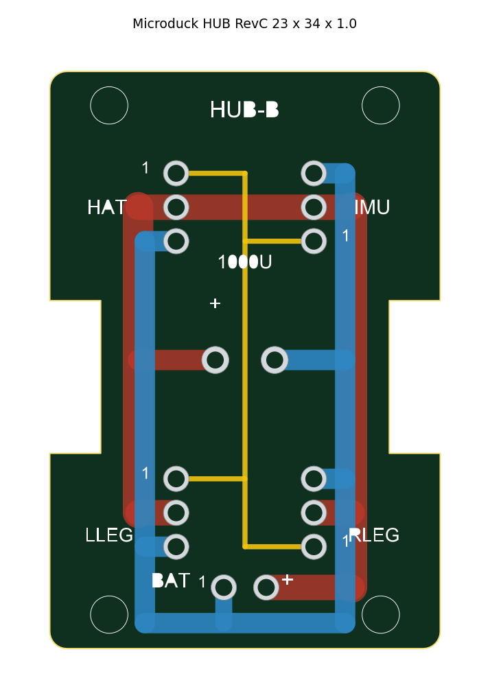
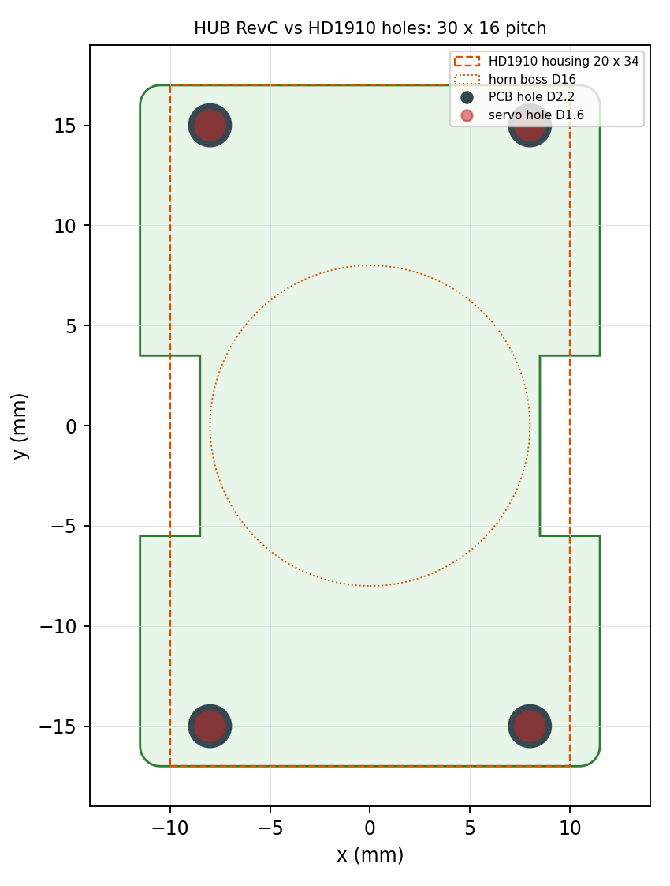

# Microduck HUB 分线板 RevC

**简体中文** | [English](README.en.md)



给 **Microduck（飞特 Feetech HD1910，15 个舵机）** 用的**纯无源四路总线 HUB**。
电池、HAT、IMU、左右腿四条线汇到一块 23 × 34 mm 的小板上，板上预留 1000 µF 总电源缓冲电容位置。

## 这块板解决什么问题

HD1910 是串联总线舵机：15 个舵机、HAT、IMU 和电池其实挂在**同一条三线总线**上，缺的只是"把线分成几路"的地方。
官方的做法是在两个髋舵机外壳顶上放一块分线板；这份开源工程就是那类分线板的**另一份从零实现的版本**：同样的外形轮廓和端口定义，但布局、丝印、Gerber 和生成脚本都是独立写的，方便你改孔位、改端口数、自己打样。

## 规格

| 项 | 值 |
| --- | --- |
| 外形 | 23.0 × 34.0 mm（两侧有让位缺口，照 HD1910 结构件轮廓） |
| 层数 / 板厚 | 2 层 / **1.0 mm**（1.6 mm 会顶到舵机，见下方警告） |
| 安装孔 | 4 × Ø2.2（M2 通孔），孔距 **30 × 16**，和 HD1910 外壳 Ø1.6 孔位同心 |
| 端口 | 4 × AMP2.0-3P 直插母座（底面）+ 1 × 2P 电池座（顶面） |
| 电容 | 1000 µF / 16 V，脚距 3.5 mm，Ø8 × 8~9 mm（底面） |
| 走线 | B 面整层 VBAT 主干（1.8 mm）、F 面 GND 环 + DATA 星形（0.3 mm） |
| 过孔 / 跳线 | **0 / 0**（两面各走各的，不借过孔） |
| 元器件总数 | 6（4 个 3P 母座 + 1 个 2P 座 + 1 个电容） |



上面这张图是孔位核验：橙色虚线是舵机 20 × 34 的安装面，红点是舵机外壳 Ø1.6，深灰是板上 Ø2.2，四个孔同心。

## 端口与针序（焊之前先看这一段）

四个 3P 口的针序**不是四个都一样**，是两个方向镜像的，1 号针 = **DATA**：

| 端口 | 位置 | pin1（DATA）在 | pin2 | pin3 |
| --- | --- | --- | --- | --- |
| HAT | 左上 | 最上 | VBAT | GND |
| IMU | 右上 | 最下 | VBAT | GND |
| LLEG | 左下 | 最上 | VBAT | GND |
| RLEG | 右下 | 最下 | VBAT | GND |
| BAT | 底部中间（顶面） | 左 = GND（−） | 右 = VBAT（+） | — |
| C1 | 板中心（底面） | 左焊盘 = +（VBAT） | 右焊盘 = GND | — |

板子上每个 3P 口旁边都有丝印名和一个数字 1，**以丝印为准**，不要靠插头的防呆凸起来判断方向。
详细的接线方式见 [docs/WIRING.md](docs/WIRING.md)。

## 打样（嘉立创）

直接上传 hardware/gerber/Microduck-HUB-RevC-Gerber.zip：

| 项 | 值 |
| --- | --- |
| 尺寸 / 层数 | 23 × 34 mm / 2 层 |
| 板厚 | **1.0 mm** |
| 铜厚 | 1 oz 够用，2 oz 更稳 |
| 表面处理 | 有铅喷锡 / 无铅喷锡 / OSP 都可以，无铅 OSP 最省 |
| 阻焊 / 字符 | 绿色 / 白色 |
| 数量 | 5 片（样板价 30 元上下；有免费打样券时可以做到 0 元，券只能在嘉立创下单小助手或手机 APP 里核销） |

> 板厚别随手改成 1.6 mm。舵机安装面中间有 Ø16 的出力轴凸台，板子必须垫高约 6.3 mm 才能平放；
> 结构件是按 1.0 mm 板厚 + 6.3 mm 垫高算的余量，换成 1.6 mm 会顶到舵机，需要自己把垫高改小 0.6 mm、螺丝相应短 0.6 mm。

## BOM（一共 6 个元件）

| 位号 | 器件 | 规格 | 数量 |
| --- | --- | --- | ---: |
| CN2–CN5 | AMP2.0 3P 直插母座 | A2007WV-3P（"AMP2.0-3P"），脚距 2.0 | 4 |
| CN1 | 2P 直插 | 脚距 2.5（EH2.5 / XH2.54 偏差 0.02 mm 也能插），或直接焊电池线 | 1 |
| C1 | 电解电容 | 1000 µF / 16 V，脚距 3.5，优先选矮的（8 × 8 mm） | 1 |

装配和自检细节见 [docs/BOM.md](docs/BOM.md) 与 [docs/ASSEMBLY.md](docs/ASSEMBLY.md)。

## 仓库结构

```text
README.md
README.en.md                        英文说明 / English documentation
LICENSE                             CERN-OHL-S-2.0
hardware/
  Microduck-HUB-RevC.kicad_pcb      KiCad 工程（可直接导入嘉立创专业版 / LCEDA）
  board.json                        外形轮廓、焊盘、走线的机器可读描述
  pads.csv                          16 个焊盘的坐标 / 钻径 / 网络
  gerber/                           Gerber RS-274X + Excellon 钻孔 + 打包好的 zip
  img/preview.png                   顶面布线预览
  img/servo-fit.png                 板孔与舵机外壳孔位对位核验图
docs/
  WIRING.md                         端口定义、整机接线、线序核对方法
  BOM.md                            元器件清单与替代件
  ASSEMBLY.md                       焊接顺序、装机、万用表自检表
  DESIGN-NOTES.md                   为什么这么布、几何与 DRC 复核数据、版本历史
tools/                              生成脚本（改孔位、重新出 Gerber）
```

## 自己改版、重新生成

孔距、孔径、端口位置都在 tools/gen_hub_v2.py 里，改完跑三条命令重出全套产物：

```bash
pip install -r tools/requirements.txt
python tools/gen_hub_v2.py         # Gerber + 钻孔 + preview.png + pads.csv + board.json
python tools/gen_hub_v2_kicad.py   # Microduck-HUB-RevC.kicad_pcb
python tools/hub_v3_servo_check.py # servo-fit.png 对位核验图
```

脚本会把产物写回 hardware/ 目录。

## 许可

[CERN-OHL-S-2.0](LICENSE)（强互惠开源硬件许可）。

- 可以：自己打样、装机、改设计，甚至做成成品出售。
- 条件：改版后必须同样开源，保留署名和许可。

## 致谢

- [Pollen Robotics Microduck](https://github.com/pollen-robotics/microduck)：鸭子外形、15 舵机关节布局与动作模型的上游。
- [kissqy/Microduck-kissqy](https://github.com/kissqy/Microduck-kissqy)：HD1910 复刻版。**本板的端口定义、网络分配和外形轮廓参考该项目公开的 HAT / IMU / HUB 说明**；该仓库的 HAT、IMU、HUB 设计资料版权归原作者，按其个人非商业条款发布，本仓库不包含其任何文件。
- [飞特 Feetech HD1910](https://www.feetechrc.com/)：舵机与总线协议。


